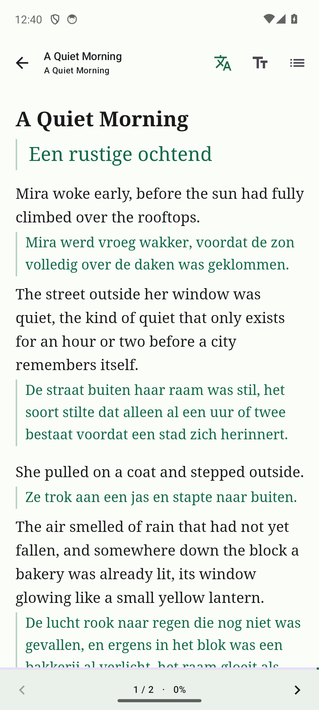
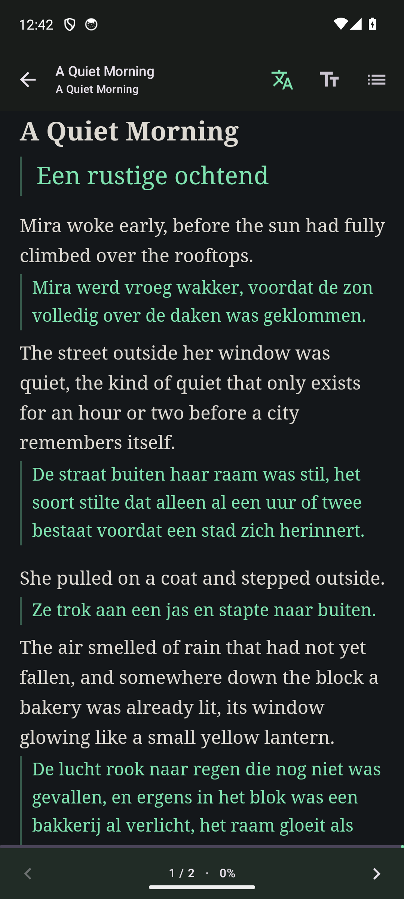
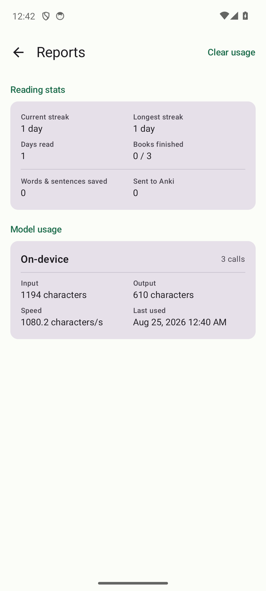

# Lingua Reader

Read EPUBs and PDFs with live sentence-by-sentence translation, look up or listen to any word, and turn what you read into an Anki deck as you go.

  
  
  

## What it does

- **Sentence-by-sentence translation** — inline, on its own line, or hidden until you tap it, for any EPUB or PDF you import.
- **Word and sentence lookup** — a definition, an AI explanation, or a quick dictionary hit, plus text-to-speech in both languages.
- **One-tap Anki export** — sends a word or sentence straight to AnkiDroid as a ready-made flashcard, pronunciation audio included.
- **Translate for free, on-device** — downloaded language packs work entirely offline. Prefer higher-quality results? Connect DeepL, Azure, OpenRouter, or your own server with your own API key.
- **Reading stats & streaks** — tracks your reading activity across every book in your library.
- **Cross-device sync** — optionally sign in with Google to sync your library, saved words, cached translations, and reading position across devices, all through your own private Google Drive storage.
- **Two starter books and a full in-app guide** are bundled in, so there's something to read from the first launch.

No account required. No ads. No tracking.

## Privacy

See [privacy-policy.md](privacy-policy.md) for what Lingua Reader does and does not do with your data — in short: nothing is collected or sent to the developer. Translation happens on-device or, if you choose to configure one, directly between your device and the provider you picked, using a key you supply. Optional sync stores your data in your own Google Drive account, not on any server the developer runs.

## Support

Questions or issues: gaborkalmar83@gmail.com
